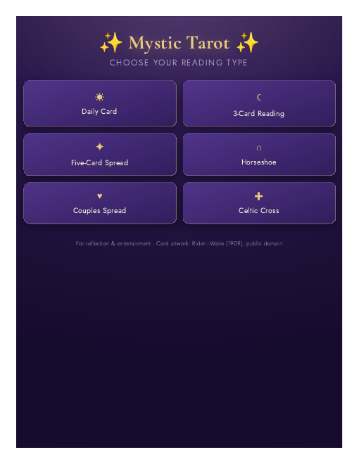

# ✨ Mystic Tarot ✨

**Choose your reading.**

Mystic Tarot is a small tarot reading web app. Pick a reading type and draw your cards — a quick 3-card reading, or the full Celtic Cross spread.

🔮 **Play it live:** https://adorable-praline-a543c9.netlify.app/

## Gallery

*The home screen — choose your reading type to begin.*

## Readings

- **3-Card Reading** — a quick three-card draw
- **Celtic Cross** — the classic ten-card spread

## About this project

A personal project — a React web app hosted on Netlify. It is also connected to **THONEY**, my AI robot assistant, where it opens from the **Tarot Card** button under Games.

This repository is the project's showcase page. The game itself is played live at the link above; source files can be added here in the future.

## Author

**Honey-Leen Jamiro Rivera**
GitHub: https://github.com/honeyleenjr
LinkedIn: https://www.linkedin.com/in/honeyleenjr
